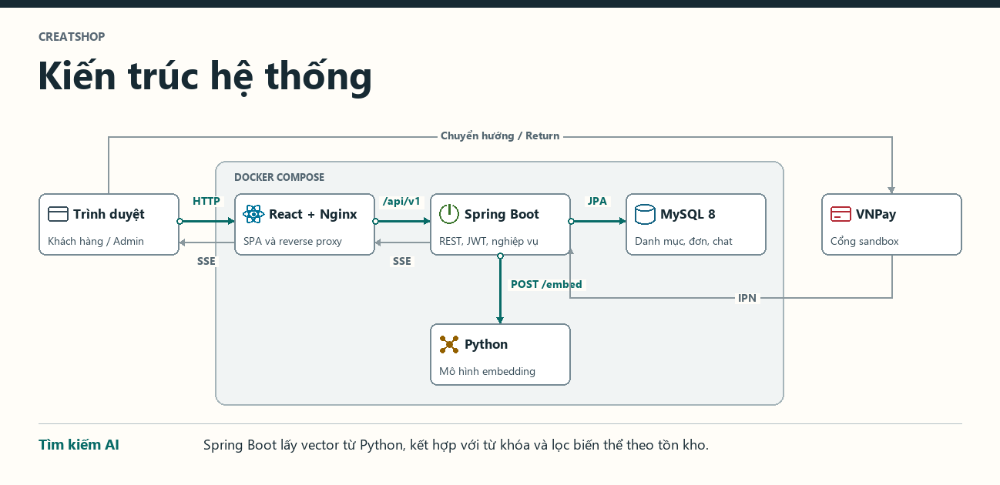

<p align="center">
  
</p>

<h1 align="center">CreaTShop</h1>

<p align="center"><strong>Cửa hàng thời trang với tìm kiếm tiếng Việt, quản lý biến thể và thanh toán VNPay.</strong><br>Đồ án Thực tập cơ sở ngành 2025</p>

<p align="center"><strong>Tên đề tài: Xây dựng hệ thống thương mại điện tử thời trang ứng dụng trí tuệ nhân tạo trong tìm kiếm ngữ nghĩa và gợi ý sản phẩm cá nhân hóa</strong></p>

<p align="center">
  <a href="https://github.com/MinhHieuDev2005/TTCSN-2025/actions/workflows/ci.yml"></a>
  <a href="https://github.com/MinhHieuDev2005/TTCSN-2025/releases/latest"></a>
</p>

[📸 Giao diện](#giao-diện) · [🧩 Kiến trúc](#kiến-trúc) · [🛍️ Tính năng](#tính-năng) · [🚀 Chạy demo](#chạy-demo) · [📂 Cấu trúc thư mục](#cấu-trúc-thư-mục) · [🧪 Kiểm thử](#kiểm-thử)

## Giao diện

**🏠 Trang chủ** — Điểm vào danh mục thời trang và ô tìm kiếm.

[](docs/anh/trang-chu.webp)

| 🔎 Tìm kiếm bằng tiếng Việt | 👟 Chi tiết sản phẩm |
| --- | --- |
| [](docs/anh/tim-kiem.webp) | [](docs/anh/chi-tiet.webp) |
| Kết quả cho truy vấn `giày nam` với bộ lọc còn hàng ở API. | Giày Biti’s Hunter Street với ảnh, màu và size đã chọn từ biến thể còn hàng. |

<details>
<summary>📱 Xem trang chi tiết trên điện thoại</summary>


</details>

**📊 Dashboard quản trị** — Theo dõi giá trị đơn đã thanh toán, đơn cần xử lý và tình trạng tồn kho. Ảnh chụp giao diện với số liệu mô phỏng.

[](docs/anh/dashboard-admin.webp)

## Kiến trúc

[](docs/anh/kien-truc-tong-the.gif)

Trong Docker demo, Nginx phục vụ SPA React và proxy `/api/`, `/oauth2/` và `/login/oauth2/` cùng origin. Spring Boot xử lý xác thực, nghiệp vụ và truy cập MySQL. Dịch vụ Python chạy mô hình embedding và trả vector cho backend. [Thiết lập tìm kiếm AI](docs/AI_DISCOVERY.md)

| Luồng | Đường đi và trách nhiệm |
| --- | --- |
| **Tìm kiếm** | React gọi `/api/v1/products/search`. Spring Boot kết hợp từ khóa và vector khi dùng chế độ hybrid, áp dụng điều kiện màu, size và tồn kho trên cùng biến thể. Khi bộ mã hóa gặp lỗi, API có thể trả kết quả từ khóa kèm lý do fallback. |
| **Thanh toán** | Spring Boot lưu đơn, giữ tồn kho và tạo URL có chữ ký. Trình duyệt chuyển sang VNPay sandbox, sau đó quay về trang kết quả. Backend xác minh dữ liệu trả về và xử lý IPN qua endpoint riêng. |
| **Chat hỗ trợ** | React gửi tin qua REST và nhận sự kiện qua SSE. Spring Boot kiểm tra quyền truy cập hội thoại và lưu lịch sử trong MySQL. |
| **Tích hợp ngoài** | Spring Boot cấu hình riêng Google/Facebook OAuth2, Cloudinary và VNPay. [Cấu hình backend](docs/BACKEND_CONFIG.md) |

## Tính năng

| Khách hàng | Quản trị |
| --- | --- |
| Tìm sản phẩm bằng từ khóa hoặc truy vấn tiếng Việt. Xem gợi ý tương tự và gợi ý cá nhân hóa. | Quản lý sản phẩm, danh mục, ảnh và tồn kho từng biến thể. |
| Chọn màu và size, cập nhật giỏ, quản lý địa chỉ, đặt COD hoặc thanh toán VNPay sandbox. | Theo dõi đơn, trạng thái giao hàng và thanh toán COD. |
| Xem lịch sử đơn, hủy khi đủ điều kiện và chat với cửa hàng. | Xem dashboard, quản lý tài khoản và trả lời hội thoại hỗ trợ. |

## Chạy demo

Bản demo dùng Docker Compose, MySQL 8 và bộ dữ liệu tổng hợp đi kèm. Chuẩn bị Docker Compose v2, Python 3.11 và cache mô hình theo [hướng dẫn AI](docs/AI_DISCOVERY.md). Chạy từ thư mục gốc trên Windows.

```powershell
py -3.11 CreaTShop-ai/prepare_demo.py backups/synthetic-demo.env
docker compose --env-file backups/synthetic-demo.env -f CreaTShop-server/creatshop/docker-compose.demo.yml -p creatshop-synthetic-demo up -d --build --wait --wait-timeout 300
```

Mở **http://127.0.0.1:15174**. Tự đăng ký tài khoản, tìm `giày nữ đi làm`, chọn biến thể, đặt COD rồi hủy trong lịch sử đơn. Lần khởi động sau dùng lại file env đã tạo để giữ quyền truy cập volume. [Kịch bản demo chi tiết](docs/SYNTHETIC_DEMO.md)

VNPay, OAuth và Cloudinary cần cấu hình riêng nếu muốn trình diễn. [Nghiệm thu nhà cung cấp](docs/EXTERNAL_ACCEPTANCE.md)

### Kịch bản trình diễn

| Bước | Thao tác | Kết quả để đối chiếu |
| --- | --- | --- |
| 🔎 Tìm hàng | Tìm bằng tiếng Việt, mở một sản phẩm và chọn biến thể còn hàng. | Tên, giá, màu và size hiển thị đúng ở giỏ hàng. |
| 📦 Đặt và hủy COD | Thêm địa chỉ, đặt COD rồi hủy đơn từ lịch sử nếu còn đủ điều kiện. | Đơn chuyển sang trạng thái đã hủy và tồn kho được hoàn lại. |
| 💳 Thanh toán sandbox | Với merchant sandbox đã cấu hình, chọn VNPay và hoàn tất bằng thẻ thử nghiệm. | Trang kết quả hiển thị giao dịch thành công và thanh toán trong đơn chuyển sang `COMPLETED`. |
| 💬 Hỗ trợ khách hàng | Gửi tin từ tài khoản khách và trả lời bằng tài khoản quản trị demo. | Tin nhắn mới tới qua SSE và lịch sử vẫn còn sau khi tải lại. |

## Cấu trúc thư mục

```text
CreaTShop-Client/
├── src/pages/               Các trang cửa hàng, checkout và kết quả thanh toán
├── src/components/          Danh mục, sản phẩm, chat và khu quản trị
├── src/api/                 Client HTTP theo nhóm nghiệp vụ
└── tests/                   Hồi quy frontend và Playwright

CreaTShop-server/creatshop/
├── src/main/java/com/example/creatshop/
│   ├── controller/          REST API
│   ├── service/             Đơn hàng, thanh toán và nghiệp vụ
│   ├── discovery/           Tìm kiếm, biến thể và gợi ý
│   ├── security/            JWT, OAuth2 và phân quyền
│   └── repository/          Truy cập MySQL qua Spring Data JPA
├── src/test/                Hồi quy và kiểm tra HTTP
├── database/demo/           Schema và dữ liệu tổng hợp
└── docker-compose.demo.yml  React/Nginx, Spring Boot, MySQL và embedding

CreaTShop-ai/
├── server.py                HTTP API mã hóa văn bản
├── prepare_demo.py          Khởi tạo cấu hình demo riêng
└── test_*.py                Kiểm tra dịch vụ và công cụ đánh giá

scripts/                     Lệnh chạy hồi quy backend
docs/                        Hướng dẫn vận hành, nghiệm thu và báo cáo kỹ thuật
.github/workflows/           CI cho frontend, backend, MySQL và AI
```

## Kiểm thử

Chạy từ thư mục gốc với Java 17, Node.js 22.12+ và Python 3.11.

```powershell
./scripts/test-backend.ps1
Push-Location CreaTShop-Client
npm ci
node --test tests/*.test.mjs
npm run build
Pop-Location
Push-Location CreaTShop-ai
py -3.11 -m unittest discover
Pop-Location
```

Luồng VNPay sandbox đã được thử với ca thành công và hủy tại cổng. Tác vụ hết hạn được kiểm tra trên database cách ly bằng cách vượt qua mốc thời gian thanh toán. IPN có bài kiểm tra callback ký mô phỏng. Việc nhận IPN trực tiếp từ VNPay vẫn cần nghiệm thu trên endpoint HTTPS đã đăng ký.

## Tài liệu

| Mục | Liên kết |
| --- | --- |
| Vận hành | [Docker](DOCKER_GUIDE.md) · [Demo với dữ liệu tổng hợp](docs/SYNTHETIC_DEMO.md) · [Cấu hình backend](docs/BACKEND_CONFIG.md) |
| Kỹ thuật | [Báo cáo đồ án](docs/THESIS_TECHNICAL_REPORT.md) · [Tìm kiếm AI](docs/AI_DISCOVERY.md) · [Điều kiện biến thể](docs/SEARCH_VARIANT_INTENT.md) |
| Phát hành | [Git Flow và kiểm thử](docs/GIT_FLOW.md) · [Nghiệm thu tích hợp](docs/EXTERNAL_ACCEPTANCE.md) · [GitHub Releases](https://github.com/MinhHieuDev2005/TTCSN-2025/releases) |
