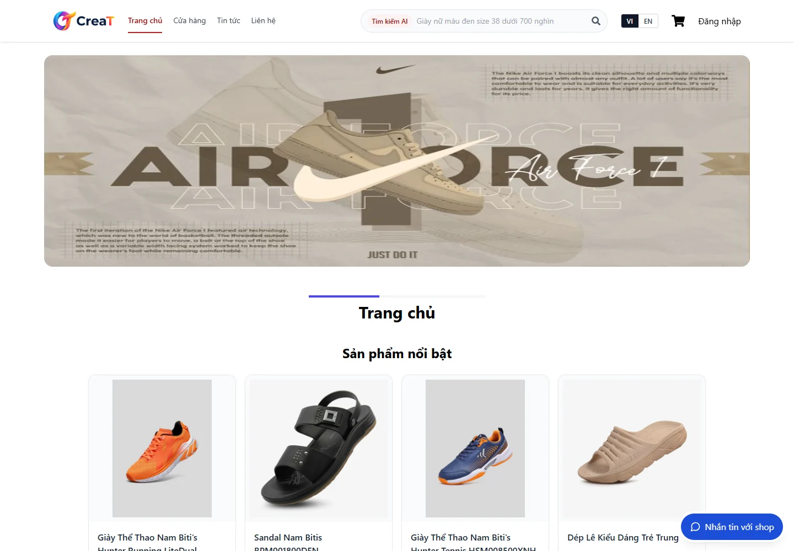
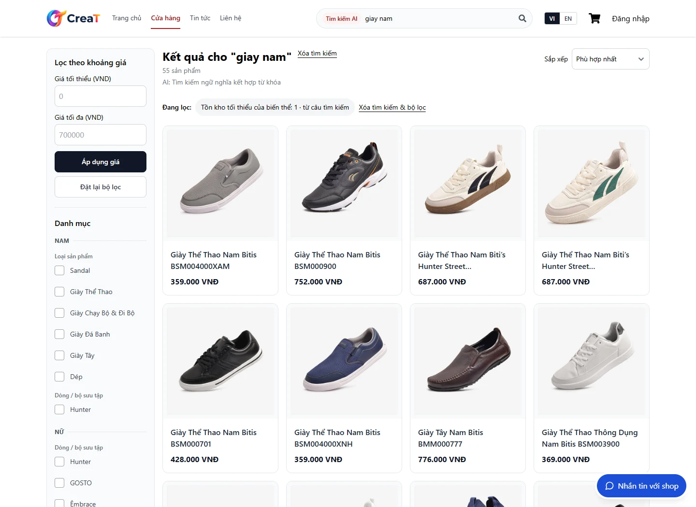
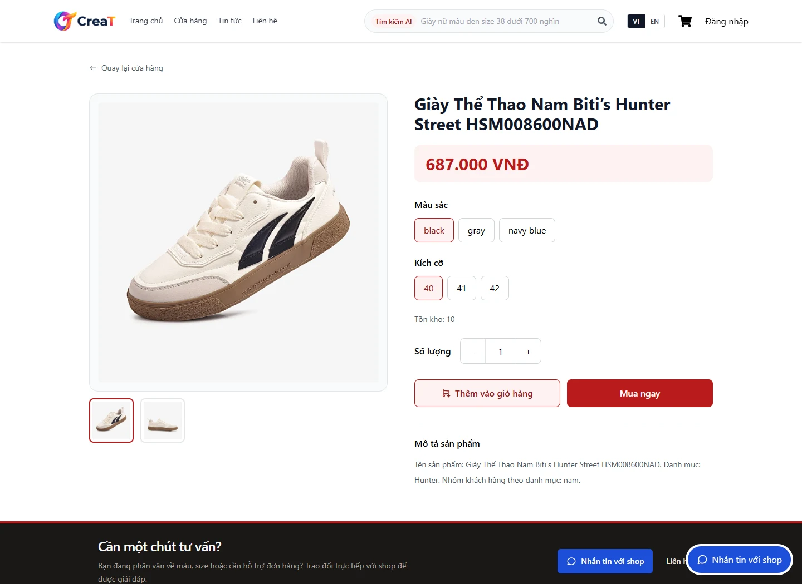
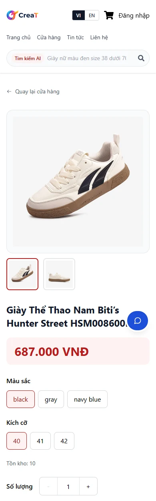
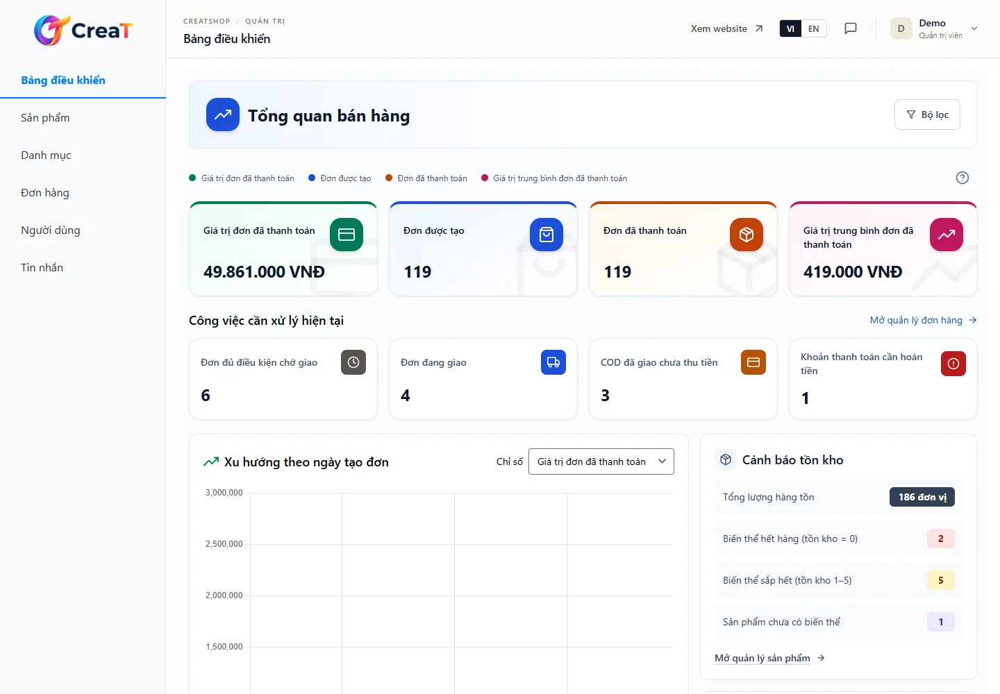

<p align="center">
  
</p>

<h1 align="center">CreaTShop</h1>

<p align="center"><strong>Tên đề tài: Xây dựng hệ thống thương mại điện tử thời trang ứng dụng trí tuệ nhân tạo trong tìm kiếm ngữ nghĩa và gợi ý sản phẩm cá nhân hóa</strong></p>

<p align="center">
  <a href="https://github.com/MinhHieuDev2005/TTCSN-2025/actions/workflows/ci.yml"></a>
  <a href="https://github.com/MinhHieuDev2005/TTCSN-2025/releases/latest"></a>
</p>

[🌐 Website public](https://creatshop.smartdeskapp.me/) · [📦 Bản phát hành v1.1.0](https://github.com/MinhHieuDev2005/TTCSN-2025/releases/tag/v1.1.0) · [🚀 Chạy demo](#cài-đặt-và-chạy-demo) · [🧪 Kiểm thử](#kiểm-thử)

## 📸 Giao diện

**🏠 Trang chủ** — Điểm vào danh mục thời trang và ô tìm kiếm.

[](docs/anh/trang-chu.webp)

| 🔎 Tìm kiếm bằng tiếng Việt | 👟 Chi tiết sản phẩm |
| --- | --- |
| [](docs/anh/tim-kiem.webp) | [](docs/anh/chi-tiet.webp) |
| Kết quả cho truy vấn `giày nam` với bộ lọc còn hàng ở API. | Giày Biti’s Hunter Street với ảnh, màu và size đã chọn từ biến thể còn hàng. |

<details>
<summary>📱 Xem trang chi tiết trên điện thoại</summary>



</details>

**📊 Dashboard quản trị** — Theo dõi giá trị đơn đã thanh toán, đơn cần xử lý và tình trạng tồn kho. Ảnh chụp giao diện với số liệu mô phỏng.

[](docs/anh/dashboard-admin.webp)

## 🧩 Kiến trúc

[](docs/anh/kien-truc-tong-the.gif)

Trong Docker demo, Nginx phục vụ SPA React và proxy `/api/`, `/oauth2/` và `/login/oauth2/` cùng origin. Spring Boot xử lý xác thực, nghiệp vụ và truy cập MySQL. Dịch vụ Python chạy mô hình embedding và trả vector cho backend. [Thiết lập tìm kiếm AI](docs/AI_DISCOVERY.md)

| Luồng | Đường đi và trách nhiệm |
| --- | --- |
| **Tìm kiếm** | React gọi `/api/v1/products/search`. Spring Boot kết hợp từ khóa và vector khi dùng chế độ hybrid, áp dụng điều kiện màu, size và tồn kho trên cùng biến thể. Khi bộ mã hóa gặp lỗi, API có thể trả kết quả từ khóa kèm lý do fallback. |
| **Gợi ý cá nhân hóa** | React ghi lượt xem của khách đã đăng nhập và gọi `/api/v1/recommendations/me`. Spring Boot dùng lượt xem, giỏ hiện tại và đơn đã giao cùng vector đã lưu để xếp hạng sản phẩm. Khi thiếu dữ liệu cá nhân hóa, giao diện hiển thị sản phẩm nổi bật. |
| **Thanh toán** | Spring Boot lưu đơn, giữ tồn kho và tạo URL có chữ ký. Với Return, VNPay chuyển trình duyệt về trang kết quả và React gọi `/api/v1/vnpay/return`. Với IPN, máy chủ VNPay gọi trực tiếp `/api/v1/vnpay/ipn`. Backend xác minh chữ ký ở cả hai đường. |
| **Chat hỗ trợ** | React gửi tin qua REST và nhận sự kiện qua SSE. Spring Boot kiểm tra quyền truy cập hội thoại và lưu lịch sử trong MySQL. |
| **Cache danh mục** | Redis lưu dữ liệu của `GET /api/v1/categories` trong 5 phút. Backend xóa cache sau khi commit thay đổi danh mục hoặc số lượng sản phẩm. Khi Redis mất kết nối, API đọc trực tiếp MySQL. |
| **Tích hợp ngoài** | Spring Boot cấu hình riêng Google/Facebook OAuth2, Cloudinary và VNPay. [Cấu hình backend](docs/BACKEND_CONFIG.md) |

## 🛍️ Tính năng

| Khách hàng | Quản trị |
| --- | --- |
| Tìm sản phẩm bằng từ khóa hoặc truy vấn tiếng Việt. Xem gợi ý tương tự và gợi ý cá nhân hóa. | Quản lý sản phẩm, danh mục, ảnh và tồn kho từng biến thể. |
| Chọn màu và size, cập nhật giỏ, quản lý địa chỉ, đặt COD hoặc thanh toán VNPay sandbox. | Theo dõi đơn, trạng thái giao hàng và thanh toán COD. |
| Xem lịch sử đơn, hủy khi đủ điều kiện và chat với cửa hàng. | Xem dashboard, quản lý tài khoản và trả lời hội thoại hỗ trợ. |

## Cài đặt và chạy demo

Bản demo dùng Docker Compose, MySQL 8, Redis và bộ dữ liệu tổng hợp đi kèm. Compose chờ Spring Boot trả lời API sản phẩm trước khi khởi động frontend.

1. Cài Docker với Compose v2, Git và Python 3.11. Tải cache mô hình theo [hướng dẫn AI](docs/AI_DISCOVERY.md).
2. Clone repo và chuyển vào thư mục dự án.

```powershell
git clone -b v1.1.0 https://github.com/MinhHieuDev2005/TTCSN-2025.git
cd TTCSN-2025
```

3. Tạo cấu hình riêng và khởi động Docker từ thư mục gốc trên Windows.

```powershell
py -3.11 CreaTShop-ai/prepare_demo.py backups/synthetic-demo.env
docker compose --env-file backups/synthetic-demo.env -f CreaTShop-server/creatshop/docker-compose.demo.yml -p creatshop-synthetic-demo up -d --build --wait --wait-timeout 300
```

Mở **http://127.0.0.1:15174**. Tự đăng ký tài khoản, tìm `giày nữ đi làm`, chọn biến thể, đặt COD rồi hủy trong lịch sử đơn. Lần khởi động sau dùng lại file env đã tạo để giữ quyền truy cập volume. [Kịch bản demo chi tiết](docs/SYNTHETIC_DEMO.md)

VNPay, OAuth và Cloudinary cần cấu hình riêng nếu muốn trình diễn. [Nghiệm thu nhà cung cấp](docs/EXTERNAL_ACCEPTANCE.md)

Để tắt cache, đặt `CATEGORY_CACHE_ENABLED=false` trong file env của demo rồi chạy lại Docker Compose. API danh mục sẽ đọc trực tiếp MySQL.

### 📦 Catalog mẫu mở rộng

Docker demo tự nạp 12 sản phẩm mẫu khi khởi tạo MySQL lần đầu. Nếu bạn được gửi gói `CreaTShop-v1.1.0-catalog-15173.zip`, hãy dùng hướng dẫn `README.txt` trong ZIP để khởi tạo một stack demo riêng với 149 sản phẩm, 157 biến thể và 20 danh mục. Gói dùng ảnh minh họa, có sẵn embedding tìm kiếm và cho phép bạn tự đăng ký tài khoản trên máy mình.

### 🎬 Kịch bản trình diễn

| Bước | Thao tác | Kết quả để đối chiếu |
| --- | --- | --- |
| 🔎 Tìm hàng | Tìm bằng tiếng Việt, mở một sản phẩm và chọn biến thể còn hàng. | Tên, giá, màu và size hiển thị đúng ở giỏ hàng. |
| 📦 Đặt và hủy COD | Thêm địa chỉ, đặt COD rồi hủy đơn từ lịch sử nếu còn đủ điều kiện. | Đơn chuyển sang trạng thái đã hủy và tồn kho được hoàn lại. |
| 💳 Thanh toán sandbox | Với merchant sandbox đã cấu hình, chọn VNPay và hoàn tất bằng thẻ thử nghiệm. | Trang kết quả hiển thị giao dịch thành công và thanh toán trong đơn chuyển sang `COMPLETED`. |
| 💬 Hỗ trợ khách hàng | Gửi tin từ tài khoản khách và trả lời bằng tài khoản quản trị demo. | Tin nhắn mới tới qua SSE và lịch sử vẫn còn sau khi tải lại. |

## 📂 Cấu trúc thư mục

```text
CreaTShop-Client/
├── src/pages/               Các trang cửa hàng, checkout và kết quả thanh toán
├── src/components/          Danh mục, sản phẩm, chat và khu quản trị
├── src/api/                 Client HTTP theo nhóm nghiệp vụ
└── tests/                   Hồi quy frontend và Playwright

CreaTShop-server/creatshop/
├── src/main/java/com/example/creatshop/
│   ├── controller/          REST API
│   ├── service/             Đơn hàng, thanh toán và nghiệp vụ
│   ├── discovery/           Tìm kiếm, biến thể và gợi ý
│   ├── security/            JWT, OAuth2 và phân quyền
│   └── repository/          Truy cập MySQL qua Spring Data JPA
├── src/test/                Hồi quy và kiểm tra HTTP
├── database/demo/           Schema và dữ liệu tổng hợp
└── docker-compose.demo.yml  React/Nginx, Spring Boot, MySQL, Redis và embedding

CreaTShop-ai/
├── server.py                HTTP API mã hóa văn bản
├── prepare_demo.py          Khởi tạo cấu hình demo riêng
└── test_*.py                Kiểm tra dịch vụ và công cụ đánh giá

scripts/                     Lệnh chạy hồi quy backend
docs/                        Hướng dẫn vận hành, nghiệm thu và báo cáo kỹ thuật
.github/workflows/           CI cho frontend, backend, MySQL và AI
```

## Kiểm thử

Chạy từ thư mục gốc với Java 17, Node.js 22.12+ và Python 3.11.

```powershell
./scripts/test-backend.ps1
Push-Location CreaTShop-Client
npm ci
node --test tests/*.test.mjs
npm run lint
npm run build
Pop-Location
Push-Location CreaTShop-ai
py -3.11 -m unittest discover
Pop-Location
```

Bộ E2E trên Chrome chạy qua tìm kiếm AI, đăng ký, đăng nhập, giỏ hàng, đặt và hủy đơn COD, khôi phục tồn kho và kết nối lại chat. Bản `v1.1.0` đã qua 11 nhóm E2E trên staging. Sau triển khai, production đã qua smoke test các trang public, API sản phẩm và danh mục. [Cách chạy E2E trên Docker demo](docs/SYNTHETIC_DEMO.md)

VNPay IPN có bài kiểm tra callback ký mô phỏng. Việc nhận IPN trực tiếp từ VNPay vẫn cần nghiệm thu trên endpoint HTTPS đã đăng ký.

## 📚 Tài liệu

| Mục | Liên kết |
| --- | --- |
| Vận hành | [Chạy demo với dữ liệu tổng hợp](docs/SYNTHETIC_DEMO.md) · [Xử lý lỗi Docker](docs/SYNTHETIC_DEMO.md#xử-lý-lỗi-docker) · [Cấu hình backend](docs/BACKEND_CONFIG.md) |
| Kỹ thuật | [Báo cáo đồ án](docs/THESIS_TECHNICAL_REPORT.md) · [Tìm kiếm AI](docs/AI_DISCOVERY.md) · [Điều kiện biến thể](docs/SEARCH_VARIANT_INTENT.md) |
| Phát hành | [Git Flow và kiểm thử](docs/GIT_FLOW.md) · [Nghiệm thu tích hợp](docs/EXTERNAL_ACCEPTANCE.md) · [GitHub Releases](https://github.com/MinhHieuDev2005/TTCSN-2025/releases) |
