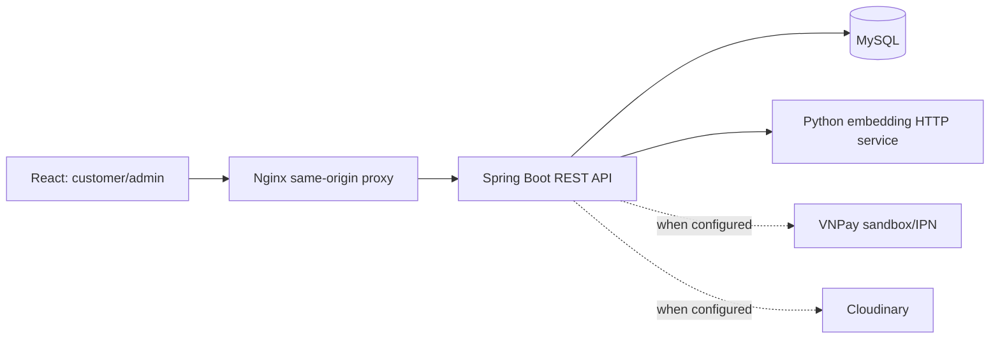
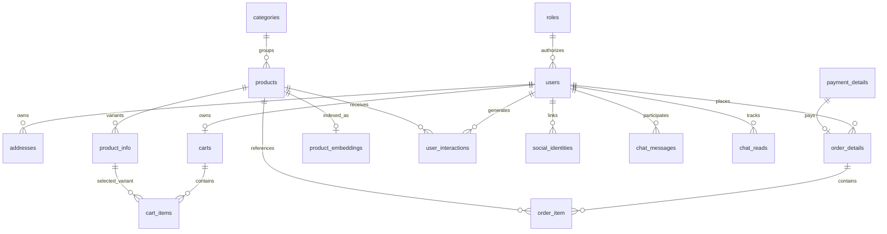

# Báo cáo kỹ thuật đồ án — bản thảo

**Đề tài:** Xây dựng hệ thống thương mại điện tử thời trang ứng dụng trí tuệ
nhân tạo trong tìm kiếm ngữ nghĩa và gợi ý sản phẩm cá nhân hóa.

**Sinh viên:** Nguyễn Minh Hiểu — 2023601749 — 2023DHCNTT02.

Đây là bản thảo nội dung kỹ thuật từ hệ thống đã triển khai và các bằng chứng
thử nghiệm. Không thay thế biểu mẫu, chữ ký, phản biện hoặc phê duyệt của
giảng viên. Không tạo kết quả phỏng vấn, khảo sát người dùng hay tài liệu
tham khảo giả. Cần trình bày lại theo quy định chính thức khi nộp.

## 1. Bài toán, phạm vi và yêu cầu

Hệ thống giúp khách hàng tìm, chọn biến thể và đặt mua sản phẩm thời trang;
quản trị viên quản lý danh mục, sản phẩm, người dùng và đơn hàng. Tìm kiếm
từ khóa đơn thuần khó xử lý cách diễn đạt nhu cầu khác tên sản phẩm; mô-đun
embedding bổ sung xếp hạng ngữ nghĩa. Gợi ý content-based sử dụng thông tin
sản phẩm kết hợp tín hiệu tương tác thay vì chỉ hiển thị một danh sách chung.

Phân tích yêu cầu hiện dựa trên nghiệp vụ mua sắm, mô hình dữ liệu và các
luồng đã triển khai; **không có khảo sát thực địa được xác nhận**. Catalog
demo chủ yếu là giày/dép; không coi thử nghiệm này đại diện mọi loại quần áo.

| Tác nhân | Nghiệp vụ |
| --- | --- |
| Khách chưa đăng nhập | Xem catalog, lọc/tìm kiếm, xem chi tiết/tương tự, đăng ký/đăng nhập |
| Khách đã đăng nhập | Quản lý hồ sơ/địa chỉ/giỏ, đặt và theo dõi đơn, hủy theo điều kiện, nhận gợi ý cá nhân, chat |
| Quản trị viên | Quản lý sản phẩm/biến thể/danh mục/người dùng, xử lý đơn, xem dashboard, xử lý chat |
| Dịch vụ ngoài | VNPay xử lý thanh toán/IPN; Cloudinary lưu ảnh; OAuth tùy cấu hình |

Yêu cầu phi chức năng: phân quyền ở server, xác thực token, không tin giá và
tồn kho từ client, bảo toàn tiền/tồn kho khi cạnh tranh và callback lặp,
không ghi bí mật vào cấu hình public, phản hồi lỗi rõ ràng, có fallback AI,
giao diện responsive và quy trình backup/restore. Không đặt chỉ tiêu SLA
production nếu chưa có thử tải đủ quy mô.

Luồng đặt hàng: chọn biến thể → thêm giỏ → chọn địa chỉ/COD hoặc VNPay →
server kiểm tra dữ liệu và tồn kho → tạo đơn/thanh toán và giữ tồn kho →
theo dõi trạng thái. Hủy/thanh toán thất bại áp dụng điều kiện chuyển trạng
thái và hoàn kho đúng một lần. Tiền thành công đến sau đơn hủy phải được
đối soát/hoàn tiền, không tự giao lại đơn đã hủy.

## 2. Kiến trúc và thiết kế dữ liệu

React chịu trách nhiệm hiển thị/tương tác, Spring Boot thực thi nghiệp vụ và
quyền truy cập, MySQL lưu dữ liệu giao dịch và vector, Python phục vụ encoder.
Embedding HTTP được tách để không đưa runtime ML vào JVM. Với catalog nhỏ,
vector được quét/xếp hạng trong tiến trình; chưa có ANN hay hàng đợi phân tán.
Đây là lựa chọn giới hạn quy mô, không phải kiến trúc chịu tải lớn đã chứng minh.

ERD là quan hệ khái niệm; DDL chính xác, index, nullable và foreign key xem
schema 16 bảng trong `database/demo/01-schema.sql`. Order item lưu thông tin
snapshot cần thiết cho lịch sử, không chỉ dựa vào giá sản phẩm hiện tại.
Tổ hợp biến thể được ràng buộc duy nhất theo sản phẩm/màu/size; số tiền dùng
kiểu decimal. Vectors gắn với model version và hash nội dung để phát hiện cũ.

## 3. Thiết kế mô-đun AI

### 3.1. Tìm kiếm

Chọn pretrained `intfloat/multilingual-e5-small`, revision cố định
`614241f622f53c4eeff9890bdc4f31cfecc418b3`, vector 384 chiều. Lựa chọn nhằm
hỗ trợ tiếng Việt/truy vấn đa ngôn ngữ và chạy CPU tại local; không khẳng định
đây là mô hình tốt nhất nếu chưa benchmark với các mô hình khác.
Đề tài tích hợp mô hình có sẵn, không tuyên bố huấn luyện foundation model.

Theo model card [1] và technical report [2], mô hình E5 phục vụ mã hóa văn bản
đa ngôn ngữ; các thông số đang chạy được cố định trong mã nguồn dự án.
Thông tin sản phẩm được ghép từ tên/danh mục/nhóm khách hàng/mô tả/metadata,
mã hóa với prefix passage. Query dùng prefix query; vector được chuẩn hóa,
giới hạn 512 tokens. Tính cosine cho semantic và kết hợp
`0.8 * cosine + 0.2 * lexical` cho hybrid. Đây là trọng số cấu hình thuật toán
hiện tại, chưa được tối ưu trên tập validation độc lập.

Giá và nhóm khách hàng được nhận bằng các quy tắc thận trọng, kết hợp bộ lọc
danh mục/biến thể/tồn kho ở server. Không mô tả mọi bước là suy luận của LLM.
Các giới hạn giá hiện là inclusive; cách diễn đạt tự nhiên “dưới” vẫn có sai
khác ở biên đúng ngưỡng, phải ghi nhận khi thiết kế kịch bản. Các công dụng
khác được dùng cho xếp hạng mềm, không đảm bảo mọi kết quả đáp ứng đầy đủ.

Index chạy theo batch, phát hiện nội dung thay đổi; giá/tồn kho không nằm
trong hash embedding nên không cần encode lại chỉ vì tồn kho đổi. Mất model
hoặc vector chưa sẵn sàng có fallback và lý do; không gọi keyword fallback là
semantic thành công. Xử lý lỗi model có cooldown để tránh retry liên tục.

### 3.2. Cá nhân hóa và tương tự

VIEW dùng lần xem mới nhất mỗi sản phẩm trong 90 ngày, trọng số
`exp(-days/30)`; cart cộng 3; sản phẩm thuộc đơn Delivered trong cửa sổ 180
ngày cộng 5. Profile là tổng vector có trọng số. Danh sách gợi ý xếp theo
cosine với profile, chỉ lấy sản phẩm còn hàng/có vector phù hợp khi cá nhân hóa.
Đồng điểm theo ID giảm dần. Sản phẩm đã tương tác chưa bị loại khỏi ứng viên.

Popular fallback dựa trên số đơn Delivered phân biệt trong 90 ngày; không có
lịch sử thì dùng thứ tự hòa điểm, không được gọi mặc định là bestseller.
Similar dùng vector của sản phẩm đang xem và loại chính nó. VIEW được gắn
với danh tính đã xác thực ở server, dedup/rate-limit và giới hạn thời gian lưu.

Đây là content-based personalization với trọng số hành vi, chưa phải
collaborative filtering. Lịch sử Delivered hiện dựa created_at và trạng thái
hiện tại, thiếu delivered_at; không dùng endpoint live để tái dựng quá khứ.

## 4. Kiểm thử và thực nghiệm

### 4.1. Tính đúng đắn và an toàn

Bằng chứng chức năng gồm unit checks, H2/HTTP, Docker thật và browser không
mock API. Các nhóm kiểm tra: cạnh tranh giữ tồn kho, callback IPN lặp/đến
muộn, hủy và hoàn kho, quyền sở hữu dữ liệu, khóa tài khoản, token giả,
gợi ý giữa tài khoản khác nhau, lọc đúng cùng biến thể, chat SSE và fallback.
Cloudinary/VNPay/OAuth trong regression có stub/test secret; không đồng nghĩa
đã kết nối thành công dịch vụ ngoài. Chi tiết đợt mới trong
`docs/COMPLETION_20261120.md`.

### 4.2. Tìm kiếm

Bộ phát triển gồm 8 queries, 120 cặp trong hợp top 10 của ba phương pháp.
AI đánh giá 110 cặp và giữ 10 chưa xác định. Precision dùng điểm > 0; biên
dưới/trên phản ánh unknown chứ không phải confidence interval. P@10:
keyword 0.6125–0.6875; semantic 0.6750–0.7375; hybrid 0.6875–0.7500.
Pooled NDCG@10 trên cùng 5 queries có nhãn đầy đủ: 0.8838, 0.8850, 0.8989.
Không báo full-catalog Recall; nhãn AI không phải independent human review.
Xem `docs/AI_ASSISTED_RESULTS.md` để hiểu các trường hợp chỉ khớp một phần.

### 4.3. Gợi ý

Do lịch sử thật chỉ có một người mua đã giao, tạo bộ mô phỏng có nguồn gốc
rõ: 48 sản phẩm, 48 người dùng, temporal split, 40 warm và 8 cold. Embedding
thật, scorer tham chiếu offline. Warm P@5/Recall@5/NDCG@5 cá nhân hóa là
0.1550/0.3875/0.2444 so với popularity 0.0350/0.0875/0.0652.
Cold-start trở về baseline và còn kết quả kém; không che số liệu này.

Bộ sinh gán sở thích và future target theo cùng nhóm, thuận lợi cho phương
pháp content-based. Kết quả chỉ xác nhận giả thuyết mô phỏng, không chứng
minh chất lượng người dùng thật. Toàn bộ dataset/vectors/results/checksums
được bàn giao; xem `docs/SYNTHETIC_RECOMMENDATION_RESULTS.md`.

### 4.4. Hiệu năng

Đợt thử tải local trước dùng 108 requests ở concurrency 1/2/4 trên catalog
149 sản phẩm; sau bounded-wait encoder, đúng requested mode và không fallback
trong bộ thử đó. Không suy rộng sang tải kéo dài, catalog lớn hay production.
Không dùng chênh lệch latency giữa các lần cache/warmup khác nhau như bằng
chứng cải thiện có kiểm soát; cần thử lạnh/nóng và tải ổn định riêng khi mở rộng.

## 5. Triển khai, hướng dẫn và kết luận

Gói nguồn có Dockerfile, schema và seed tổng hợp, ảnh local tự tạo, OpenAPI,
tests và hướng dẫn. Bản demo sạch không cần snapshot khách hàng; xem
`docs/SYNTHETIC_DEMO.md`. Cấu hình riêng/JWT/password không nằm trong gói.
Backup phục hồi logic đã kiểm tra riêng; chưa có chứng minh mất máy hoặc
backup ngoài máy. Không chuyển cấu hình thử nghiệm thành public production.

Hệ thống đã hiện thực hóa kiến trúc thương mại điện tử và hai mô-đun AI theo
đề tài. Những phần có thể hoàn thiện bằng mô phỏng được ghi rõ provenance.
Trước khi tuyên bố nghiệm thu toàn bộ vẫn cần thử VNPay sandbox/IPN qua HTTPS,
upload Cloudinary có tài khoản phù hợp, xác nhận yêu cầu đánh giá của giảng
viên, và hoàn thiện biểu mẫu/bibliography theo quy định trường. Không tự tạo
chữ ký, khảo sát người thật, merchant credentials hoặc kết quả tích hợp giả.

## Phụ lục: nguồn kiểm chứng nội bộ

- `DiscoveryService.java`, `Ranking.java`, `EmbeddingClient.java`: thuật toán thực thi.
- `docs/AI_DISCOVERY.md`: thông số model/index/fallback và giới hạn.
- `docs/ACCEPTANCE_20261120.md`, `docs/COMPLETION_20261120.md`: nghiệm thu.
- `docs/AI_ASSISTED_RESULTS.md`: phương pháp/giới hạn đánh giá tìm kiếm.
- `docs/SYNTHETIC_RECOMMENDATION_RESULTS.md`: dữ liệu và thực nghiệm gợi ý.
- `docs/BACKEND_CONFIG.md`, `docs/SYNTHETIC_DEMO.md`: cài đặt và cấu hình.

## Tài liệu tham khảo ngoài

[1] intfloat. *multilingual-e5-small model card*. Hugging Face.
https://huggingface.co/intfloat/multilingual-e5-small . Truy cập 20/11/2026.

[2] Liang Wang, Nan Yang, Xiaolong Huang, Linjun Yang, Rangan Majumder,
Furu Wei. *Multilingual E5 Text Embeddings: A Technical Report*. arXiv:2402.05672,
2024. https://arxiv.org/abs/2402.05672 . Truy cập 20/11/2026.

Các nguồn trên giải thích mô hình, không chứng minh kết quả riêng của dự án.
Khi nộp cần chuẩn hóa bibliography theo trường và bổ sung tài liệu thực sự
đã sử dụng; không suy diễn rằng có mã nguồn là đã hoàn tất khảo sát thực địa.
